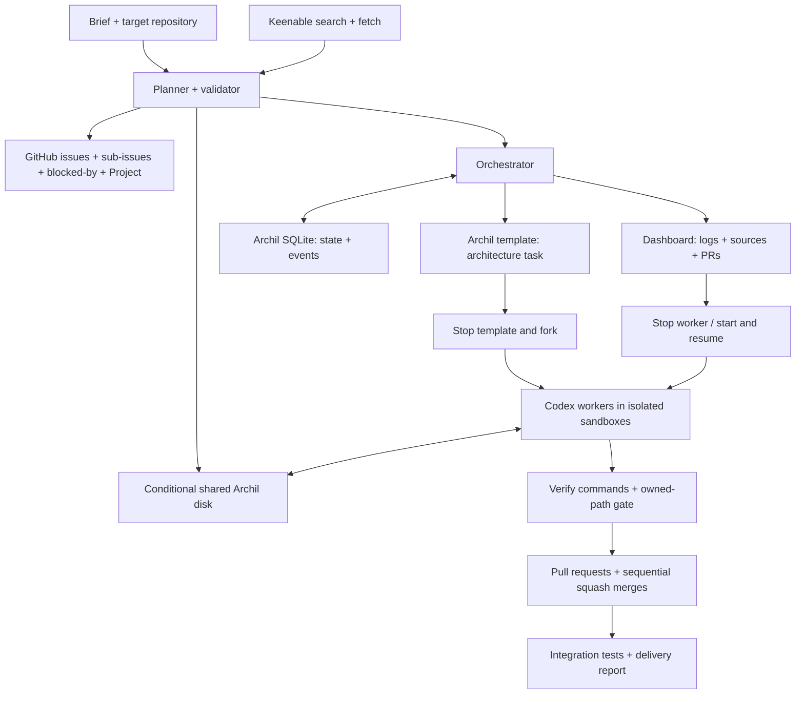

# Archil Agent Swarm

A GitHub-driven coding swarm that turns a brief and a target repository into a tested application, merged one pull request at a time. A planner uses Keenable research to create a task hierarchy, Codex workers build in durable Archil sandboxes, and a deterministic gate checks results before sequential merges.

The design and operating details below follow [docs/PLAN.md](docs/PLAN.md).

## Architecture



## Run

For a live run, prepare Archil access and a disk in **`aws-us-west-2`**. The sandboxes, disk and SQLite must use that region. Provide a GitHub token for the orchestrator and a separate contents-only token for workers to push to the target repository. Only the orchestrator calls the GitHub API.

Supply credentials through your runtime environment; keep them out of source files. The plan names these worker/model environment variables:

| Variable | Purpose |
| --- | --- |
| `OPENAI_API_KEY` | Used by the planner and supplied to sandboxed Codex as `CODEX_API_KEY`. |
| `CODEX_API_KEY` | Worker-side model credential, passed into the sandbox. |
| `AGENT=fake` | Worker mode that copies canned files instead of running Codex. |

Keenable supports keyless public search and fetch with an `X-Keenable-Title` header; a key is optional. Check Archil access and connectivity early:

```bash
npm run smoke
```

Run the swarm with a brief and a target repository (replace `<org>/<target>`):

```text
npm run swarm -- --brief demo/brief.md --repo <org>/<target> [--dry-run] [--fake-agent] [--fixture-plan] [--local]
```

The bracketed flags are optional; omit the brackets when using them. Develop with `--dry-run` to limit GitHub writes. The fake agent uses canned outputs for a quick pipeline exercise. The bookmark-manager fixture plan is in `fixtures/plan.bookmarks.json`; the live planner also falls back to the fixture if its plan fails validation.

## Archil: durable work and recovery

The architecture task runs first in a template sandbox. The orchestrator stops it and forks one sandbox per worker, giving workers the same starting code and installed dependencies. Git clones and `node_modules` stay on each sandbox's own root disk.

A shared disk mounted in **conditional mode** carries the plan, cited research, task inputs, logs, manifests and final report. Each directory has one writer. Workers sync after every file; readers invalidate the mount cache before reading, and the orchestrator signals handoffs. Unsynced writes can be lost when a sandbox is killed.

Archil SQLite stores runs, tasks, attempts, manifests and events. The orchestrator is its only writer, and the dashboard streams those events.

Pressing **Stop** on a worker interrupts its attempt. The orchestrator starts the same sandbox and creates the next attempt with `RESUME=1`; Codex continues with `codex exec resume --last` on the preserved root disk. Only the current attempt's manifest is accepted. After an orchestrator restart, running attempts are treated as interrupted and resumed.

## Keenable: cited research

The planner searches and fetches with Keenable before dispatching work, then writes cited notes to `/research/<run>/<task>/sources.md` on the shared disk. Workers read those notes rather than depending on direct Keenable access from sandboxes.

## GitHub: assignments and verified delivery

Each epic becomes an issue with task sub-issues and **blocked-by** links. Project statuses track **Backlog → Ready → Running → Review → Done**, with **Blocked** for tasks that cannot proceed. Stable run/task markers keep issue publication idempotent.

The gate re-runs every task verification command in its fork and checks that all changed files belong to the task's owned paths. A failed result gets one retry with findings, then becomes Blocked. Passing attempts receive pull requests with `Closes #n` in the body, squash-merged sequentially in dependency order.

For the bookmark-manager demo, architecture runs first; API/store, web UI and search then run in parallel forks. Integration runs `npm test` on main and writes `/delivery/<run>/report.md`. The dashboard brings together logs, research sources, PRs and the Stop control.
