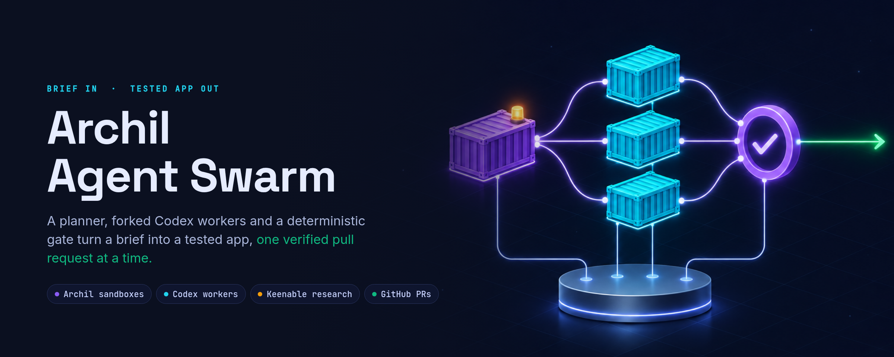
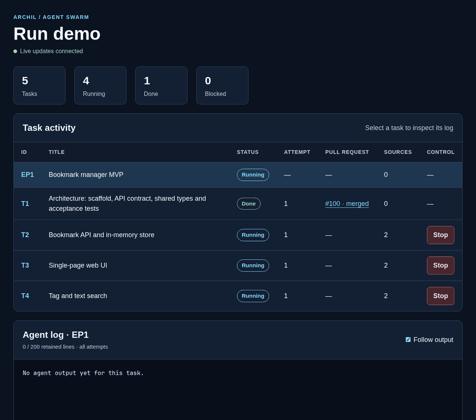
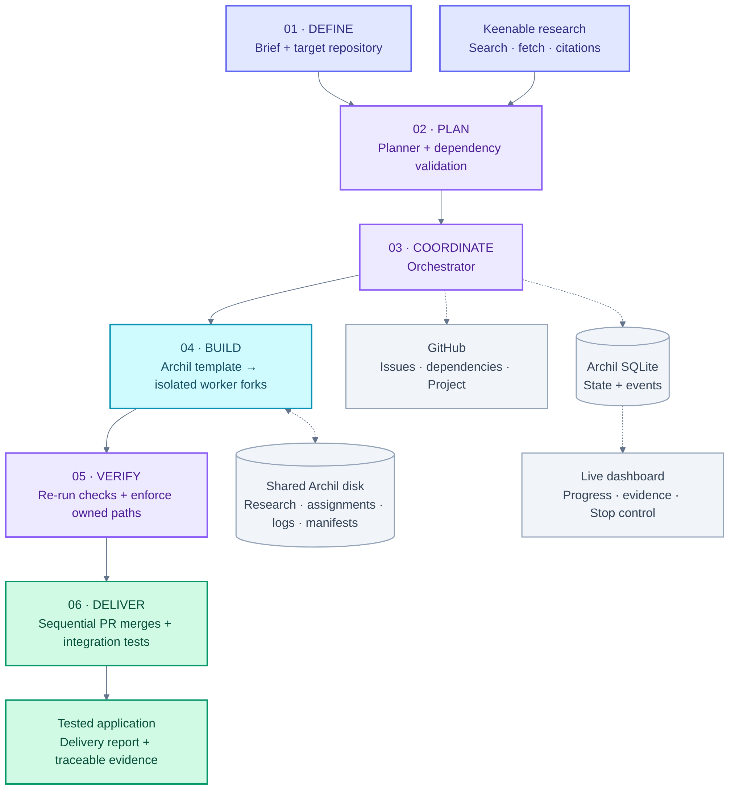
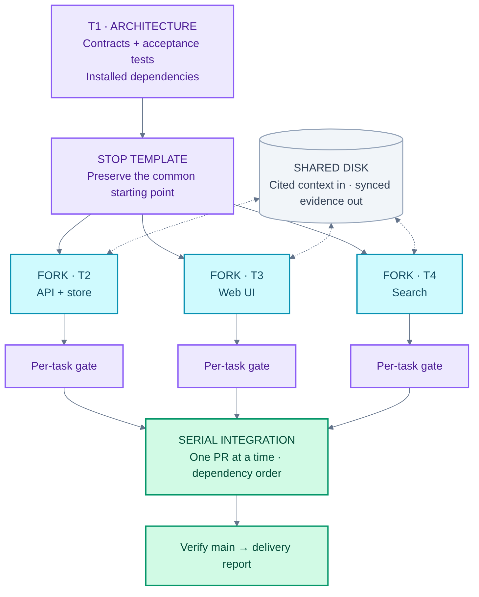
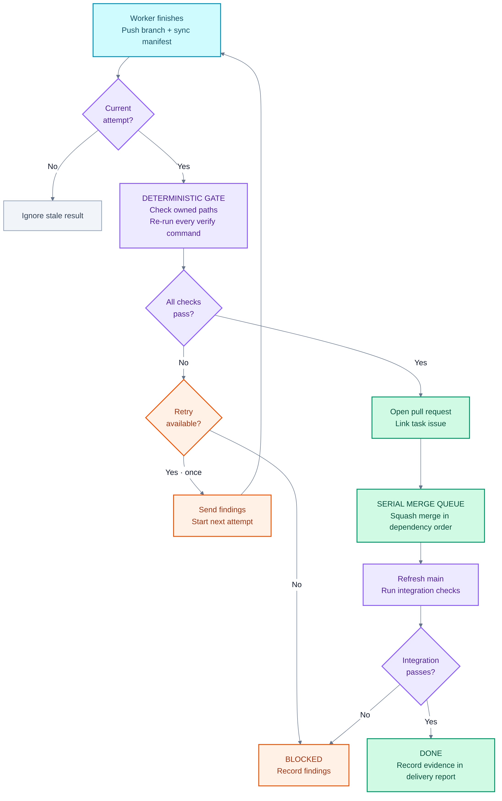
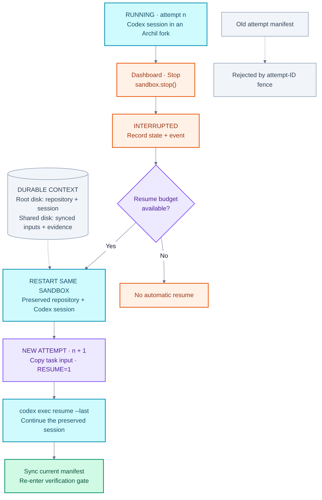
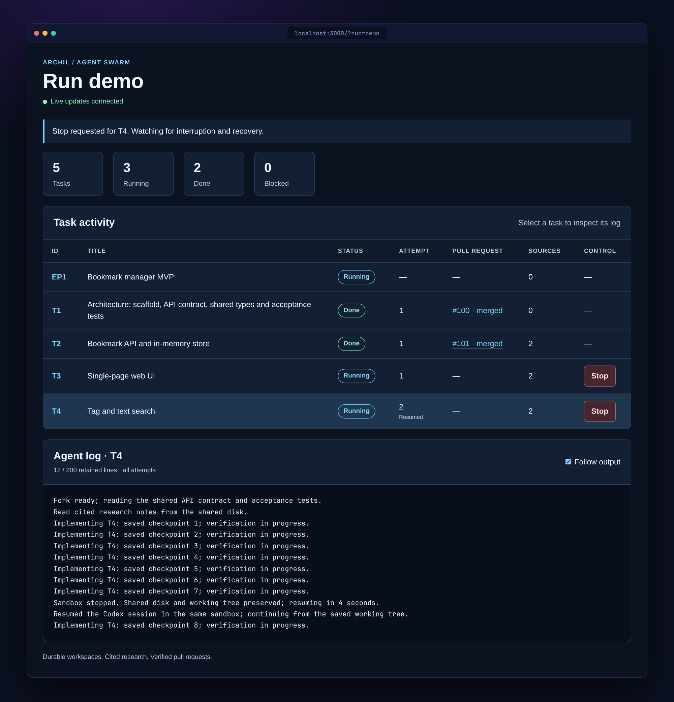

<div align="center">



<p>
  <a href="https://github.com/CompleteDotTech/archil-agent-fan-out/actions/workflows/ci.yml"></a>
  <a href="LICENSE"></a>
  
  
  
</p>

<p>
  
  
  
</p>

**[Quick start](#-quick-start)** · **[How it works](#-how-it-works)** · **[Live run](#-live-run-on-archil)** · **[Architecture](docs/architecture.md)** · **[Demo script](docs/DEMO.md)**

</div>

---

**Archil Agent Swarm** is a GitHub-driven coding swarm. Give it a **brief** and a **target repository**. It returns a **tested application**, merged one pull request at a time.

- 🔎 A **planner** grounded in cited [Keenable](https://keenable.ai) research turns the brief into GitHub issues, with sub-issues and blocked-by links.
- 🧬 The architecture task runs in an [Archil](https://archil.com) **template sandbox**. That sandbox is then stopped and **forked once per worker**, so every Codex worker starts from identical code and installed dependencies.
- ✅ A **deterministic gate** re-runs every verification command and checks that each change stays inside its task's owned paths. Passing work merges **sequentially, in dependency order**.
- ⏯️ Press **Stop** on any worker. The orchestrator restarts the *same* sandbox, and Codex **resumes its session** on the preserved disk.

> Each assignment maps to an issue, each worker has a durable workspace, and each completed task has verification evidence.

<div align="center">

<br><sub>The live dashboard (<code>npm run dashboard:demo</code>). Stop is pressed on T4: the sandbox stops, the working tree survives and attempt 2 resumes the session while PRs merge in dependency order.</sub>
</div>

## ⚡ Quick start

This needs no cloud account and no API keys. `--local` swaps Archil for a local runner and GitHub for a bare git remote. `--fake-agent` replays canned worker output, so the full pipeline runs (plan → fork → gate → sequential merge → acceptance tests) in about **10 seconds**.

```bash
git clone https://github.com/CompleteDotTech/archil-agent-fan-out.git
cd archil-agent-fan-out
npm ci
npm run swarm -- --brief demo/brief.md --repo demo/bookmarks --local --fake-agent
```

```text
Run run-2026-11-11T04-46-46-633Z-ecc1ad63 — dashboard http://localhost:3000/?run=…
Done: T1, T2, T3, T4; blocked: none
Saved report: .swarm/runs/run-…/report.md
Final acceptance suite: PASS
```

To explore the dashboard without running anything, use `npm run dashboard:demo`. It runs a simulated run at <http://localhost:3000/?run=demo> where you can press **Stop** and watch the worker resume.

## 🧭 How it works

<div align="center">

</div>

| # | Stage | What happens | Where |
|:-:|---|---|---|
| 1 | **Research** | Keenable search and fetch run *before* dispatch. Cited notes go to `/research/<run>/<task>/sources.md` on the shared disk. | [`src/research`](src/research) |
| 2 | **Plan** | AI SDK `generateObject` with a zod schema. The validator rejects cycles, missing dependencies, missing verify commands and overlapping owned paths. Invalid plans fall back to the fixture. | [`src/planner`](src/planner) |
| 3 | **Publish** | Each epic becomes an issue, with task sub-issues and **blocked-by** links. Project status moves through **Backlog → Ready → Running → Review → Done** (or **Blocked**). A paced, idempotent queue does the writes. | [`src/github`](src/github) |
| 4 | **Fork** | The architecture task runs alone in a template sandbox. The orchestrator then stops it and forks one sandbox per ready task. | [`src/archil`](src/archil) · [`src/orchestrator`](src/orchestrator) |
| 5 | **Build** | `run-task.sh` runs Codex (or the fake agent) inside each fork. It then verifies, commits, pushes an attempt branch, writes a manifest and syncs. | [`src/worker`](src/worker) |
| 6 | **Gate** | Every verify command is re-run in the fork, and every changed file must match the task's owned paths. A failing task gets one retry with findings, then becomes **Blocked**. | [`src/orchestrator/gate.ts`](src/orchestrator/gate.ts) |
| 7 | **Deliver** | PRs carry `Closes #n` and are squash-merged one at a time. Integration runs `npm test` on main and writes `/delivery/<run>/report.md`. | [`src/orchestrator/integrate.ts`](src/orchestrator/integrate.ts) |

<details>
<summary><b>🖼️ More diagrams: parallel forks, the verification gate, stop and resume</b></summary>
<br>

| Template → parallel workers | Verification gate |
|:-:|:-:|
|  |  |



The Mermaid sources live in [`docs/diagrams`](docs/diagrams), and [`render.sh`](docs/diagrams/render.sh) regenerates the PNGs.
</details>

## ✨ Highlights

<table>
<tr>
<td width="50%" valign="top">

### 🧬 Fork, don't clone
Workers never clone and install from scratch. The stopped template forks into identical sandboxes, so there's no lockfile drift and no repeated `npm install`. Git clones and `node_modules` stay on each sandbox's own root disk.

### ⏯️ Durable stop and resume
**Stop** calls `sandbox.stop()`, and the attempt is marked *interrupted*. The orchestrator creates attempt *n+1*, starts the **same** sandbox and runs the worker with `RESUME=1`, which continues via `codex exec resume --last`. Only the current attempt's manifest is accepted. After an orchestrator restart, running attempts are resumed too.



</td>
<td width="50%" valign="top">

### ✅ A deterministic gate, not a vibe check
An LLM reviewer doesn't decide whether a result passes. The orchestrator re-runs each task's verify commands in its fork and enforces owned paths. That's fast, objective and easy to reproduce.

### 🗂️ One writer per directory
The shared Archil disk runs in **conditional mode** and holds the plan, cited research, task inputs, logs, manifests and the final report. Each directory has exactly one writer. Writers sync after every file, readers invalidate the cache, and the orchestrator signals every handoff.

</td>
</tr>
</table>

```text
/spec/<run>/plan.json                         orchestrator
/research/<run>/<task>/sources.{md,json}      planner (Keenable)
/runs/<run>/<task>/<attempt>/task.json        orchestrator
/runs/<run>/<task>/<attempt>/{agent.log,final.md,verify.log,manifest.json}   that attempt's worker
/delivery/<run>/report.md                     integrator
```

Archil SQLite stores runs, tasks, attempts, manifests and events. The orchestrator is its **only writer**, and the dashboard streams the events over SSE.

## ☁️ Live run on Archil

The disk, the sandboxes and SQLite must all be in **`aws-us-west-2`**. Check access early:

```bash
npm run smoke
```

Then point the swarm at a real target repository:

```bash
npm run swarm -- --brief demo/brief.md --repo <org>/<target>
```

| Flag | Effect |
|---|---|
| `--brief <file>` | Markdown brief to plan from (required) |
| `--repo <owner/name>` | Target repository (required) |
| `--dry-run` | Don't write to GitHub; merges are applied to an integration sandbox instead |
| `--fake-agent` | Replay canned files instead of running Codex (pipeline testing) |
| `--fixture-plan` | Skip the live planner and use [`fixtures/plan.bookmarks.json`](fixtures/plan.bookmarks.json) |
| `--local` | Run fully locally: local runner, in-memory store, bare git remote |
| `--port <n>` | Dashboard port (default `3000`) |

Set credentials in your runtime environment, never in source files. Only `src/compose.ts` and `scripts/` read them.

| Variable | Required | Purpose |
|---|:-:|---|
| `ARCHIL_API_KEY` | ✅ | Archil SDK access (not needed with `--local`) |
| `ARCHIL_DISK_ID` | ✅ | Shared disk for plans, research, logs and the SQLite state |
| `ARCHIL_REGION` | | Defaults to `aws-us-west-2` |
| `OPENAI_API_KEY` | ✅ | Planner model. It's also passed into sandboxes as `CODEX_API_KEY` |
| `OPENAI_MODEL` | | Planner model override (default `gpt-5.1`) |
| `GITHUB_TOKEN` | | Orchestrator token. Without it, publishing stays dry |
| `GITHUB_PUSH_TOKEN` | | Contents-only token that workers use to push attempt branches |
| `GITHUB_PROJECT_ID` · `GITHUB_STATUS_FIELD_ID` | | Optional Project v2 board. The Status field needs **Backlog, Ready, Running, Review, Done, Blocked** |
| `GITHUB_PROJECT_URL` | | Linked from the dashboard |
| `KEENABLE_API_KEY` | | Optional. Keyless public search and fetch work too |
| `TARGET_REPO` | | Used by `npm run smoke` for the public-repo check |

> [!NOTE]
> Only the orchestrator calls the GitHub API. Workers push attempt branches with a contents-only token, so a stale attempt can never publish.

## 🗺️ Repository layout

```text
src/
├── contracts/     frozen ports (types.ts) + in-memory fakes for tests
├── planner/       generateObject planner, validator, repair, research step
├── research/      Keenable search/fetch client + cache
├── github/        paced publisher: issues, sub-issues, Project, PRs, merges
├── archil/        disk, sandbox runner, SQLite store, bundle import
├── worker/        run-task.sh + bundle.sh (runs inside each sandbox)
├── orchestrator/  scheduler, gate, integrator, recovery, metrics
├── dashboard/     Hono server + SSE + single-page UI with Stop control
├── compose.ts     wires live or local adapters from the environment
└── cli.ts         `npm run swarm`
demo/              bookmark-manager brief, target seed, assembly script
fixtures/          fixture plan, Keenable responses, canned agent output
swarm/             the Codex swarm that built this repo (see below)
docs/              plan, architecture, demo script, diagrams, assets
```

## 🐝 Built by a swarm

This repository was itself built by a recursive **Codex swarm** under a 2h20m hackathon deadline. A root orchestrator split the [plan](docs/PLAN.md) into five workstreams (A–E). Each workstream orchestrator dispatched headless `codex exec` leaf workers into isolated git worktrees, each limited to the paths it owned. The rules are in [`AGENTS.md`](AGENTS.md), the task graph is in [`swarm/tasks.yaml`](swarm/tasks.yaml), and the harness is [`swarm/bin/swarm.mjs`](swarm/bin/swarm.mjs).

| Workstream | Owns |
|:-:|---|
| **A** | planner + research |
| **B** | GitHub publisher |
| **C** | Archil adapters, worker scripts, smoke test |
| **D** | orchestrator: scheduler, gate, integrator, recovery |
| **E** | dashboard, demo target, docs |

## 🛠️ Development

```bash
npm run typecheck          # tsc --noEmit
npm test                   # vitest: 24 files, 260 tests, no network
npx vitest run tests/orchestrator
npm run dashboard:demo     # simulated dashboard on :3000
```

Tests code against the ports in [`src/contracts/types.ts`](src/contracts/types.ts) and use the fakes in [`src/contracts/fakes.ts`](src/contracts/fakes.ts), so the suite never touches the network. See [CONTRIBUTING.md](CONTRIBUTING.md) for conventions.

## 📚 Documentation

| Doc | What's inside |
|---|---|
| [docs/PLAN.md](docs/PLAN.md) | The design (plan v2) and why it changed from v1 |
| [docs/architecture.md](docs/architecture.md) | Components, data flow, lifecycle, gate and recovery in depth |
| [docs/diagrams](docs/diagrams) | Mermaid sources and the render script |
| [docs/DEMO.md](docs/DEMO.md) | 60-second and three-minute table-demo scripts |
| [docs/RECORDING.md](docs/RECORDING.md) | Rehearsal recording checklist |

## 🙏 Acknowledgments

Built for the **Archil hackathon** (November 2026) on [Archil](https://archil.com) sandboxes, disks and SQLite, with research from [Keenable](https://keenable.ai) and coding agents from [OpenAI Codex](https://github.com/openai/codex).

## 📄 License

[MIT](LICENSE) © 2026 Timothy Wayne Gregg
