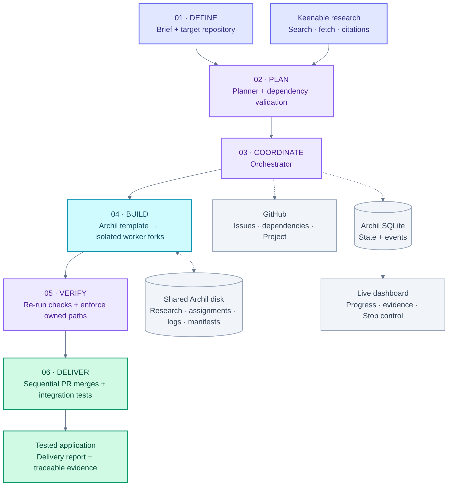
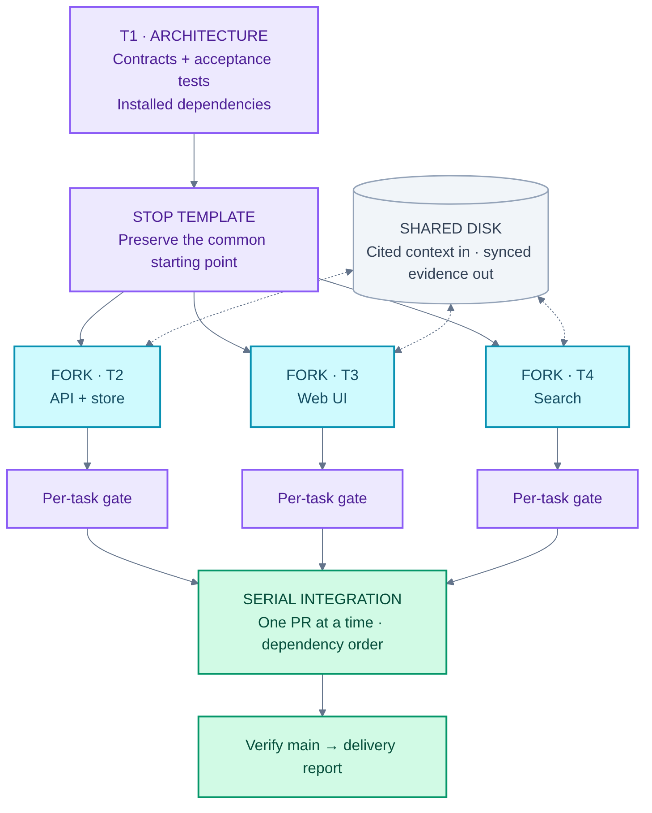
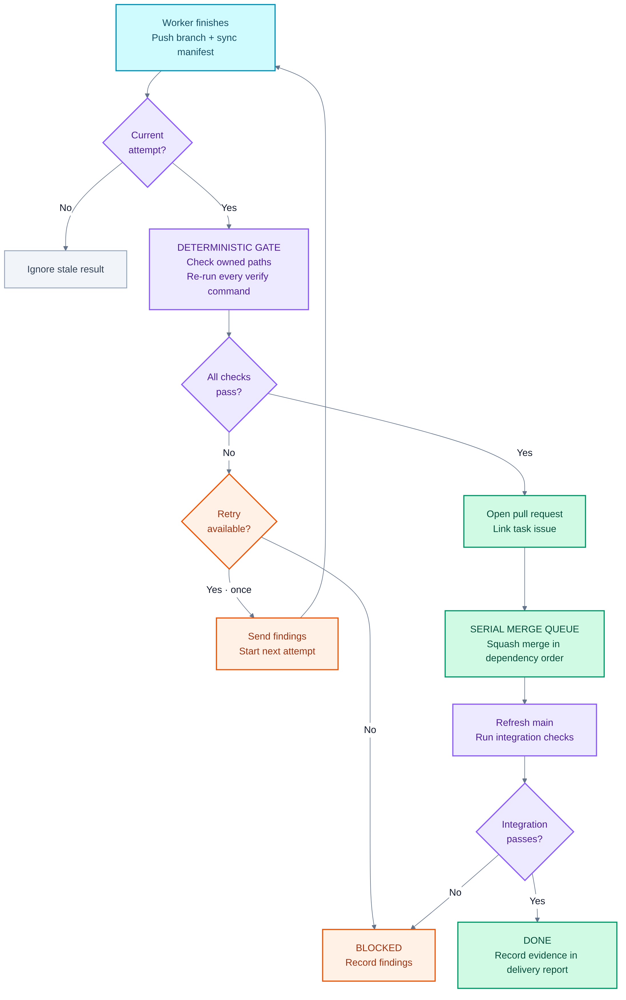
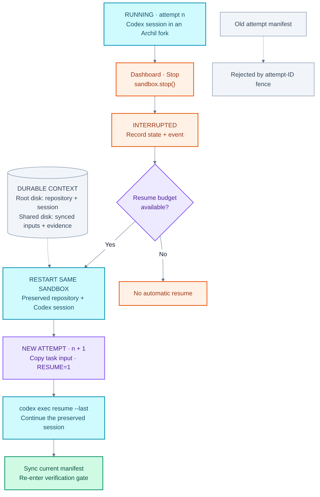

# Architecture

This document describes the design in [PLAN.md](PLAN.md). A run takes a brief and a target GitHub repository, then produces a tested application through individually verified, sequentially merged pull requests.

## Components and data flow

[Mermaid source](diagrams/overview.mmd) · [Rendering guide](diagrams/README.md)

The planner uses AI SDK `generateObject` with a zod schema. Its validator rejects cycles, missing dependencies, missing verification commands, and overlapping owned paths between parallel tasks. Keenable research runs before dispatch and supplies cited notes through the shared disk; workers do not need to call Keenable from their sandboxes. Invalid live plans fall back to the fixture plan.

The orchestrator contains the scheduler, deterministic gate, integrator, and recovery logic. It is the only GitHub API caller, using a paced queue of one write per second or slower. The publisher creates epic and task issues, sub-issue and blocked-by links, Project items and statuses, pull requests, and squash merges. Issue bodies carry a run/task marker so retries can find existing issues. Workers push attempt branches with a contents-only token.

The dashboard is a Hono server with SSE and one HTML page. It streams stored events and presents logs, sources, PRs, and a Stop button. The demo target is a bookmark manager with a seed repository and canned fake-agent outputs.

## Persistent state and ownership

Archil SQLite has one writer: the orchestrator process. It stores runs, task status and issue numbers, attempts, manifests, and indexed events. Attempt records include the attempt number, sandbox, resume flag, state, deadline, and findings. Multi-row writes use `db.transaction([...])`; the single-writer design does not need claim transactions. The disk, sandboxes, and SQLite use `aws-us-west-2`.

The shared Archil disk is mounted in conditional mode at `/mnt/archil`. Each artifact has a designated writer:

| Disk path | Writer and purpose |
| --- | --- |
| `/swarm/worker/run-task.sh`, `/swarm/fixtures/agent/<task>/` | Orchestrator uploads worker code and fixtures at run start |
| `/spec/<run>/plan.json` | Orchestrator records the plan |
| `/research/<run>/<task>/sources.{md,json}` | Planner records Keenable research and citations |
| `/runs/<run>/<task>/<attempt>/task.json` | Orchestrator supplies the assignment |
| `/runs/<run>/<task>/<attempt>/{agent.log,final.md,verify.log,manifest.json}` | That attempt's worker records output and evidence |
| `/delivery/<run>/report.md` | Integrator writes the delivery report |

Workers sync after every file with `archil sync /mnt/archil`, falling back to `sync <file>`. Unsynced writes can be lost when a sandbox is killed. The orchestrator signals each handoff; readers invalidate the mount's cache before reading, and nothing polls the disk. Clients do not use `archil checkout`, because a crashed client keeps its delegation.

Git clones, `node_modules`, and the Codex session live on each sandbox's own root disk. The shared disk carries assignments, context, and evidence between components.

## Template and worker lifecycle

[Mermaid source](diagrams/parallel-workers.mmd)

The architecture task runs alone in a template sandbox. In the bookmark demo, T1 writes the contract and acceptance tests. The orchestrator then stops the template and forks one sandbox per worker, giving workers identical code and installed dependencies. T2 (API and store), T3 (web UI), and T4 (search) can run in parallel forks.

For each dispatched attempt:

1. The orchestrator writes `task.json` and runs `run-task.sh` with run, task, attempt, base-commit, and resume parameters.
2. The worker checks out `swarm/<run>/<task>/<attempt>` and builds a prompt from the task, owned paths, verification commands, research notes, and any gate findings.
3. It runs `codex exec` inside the VM sandbox, or `codex exec resume --last` when resuming.
4. It runs verification commands, commits, and pushes the attempt branch.
5. It writes and syncs `manifest.json`, then exits.

With `AGENT=fake`, the worker copies canned files instead of invoking Codex, allowing a fast test of the pipeline.

## Deterministic gate and serialized integration

[Mermaid source](diagrams/verification-gate.mmd)

The gate accepts a result only when every changed file matches the task's owned paths and every verification command passes when the orchestrator re-runs it in the fork. A failed task gets one retry with the findings; another failure makes it Blocked.

Each passing attempt gets a pull request whose body closes its issue. Pull requests are squash-merged one at a time in dependency order. In the bookmark demo, the orchestrator runs `npm test` on main after each merge and writes the delivery report. GitHub Project status tracks Backlog, Ready, Running, Review, Done, and Blocked.

## Current-attempt fencing and stop/resume

[Mermaid source](diagrams/stop-resume.mmd)

Execution handles and deadlines track workers. Pressing Stop in the dashboard calls `sandbox.stop()`. When execution ends without a manifest, the orchestrator marks the attempt interrupted, creates attempt n+1, starts the same sandbox, and runs the worker with `RESUME=1`. Codex resumes its session on the preserved root disk.

Only the current attempt's manifest is accepted, so an old attempt cannot publish a stale result through the orchestrator. If the orchestrator restarts, it treats every running attempt as interrupted and resumes it. Stop therefore demonstrates recovery rather than permanently cancelling the task.
